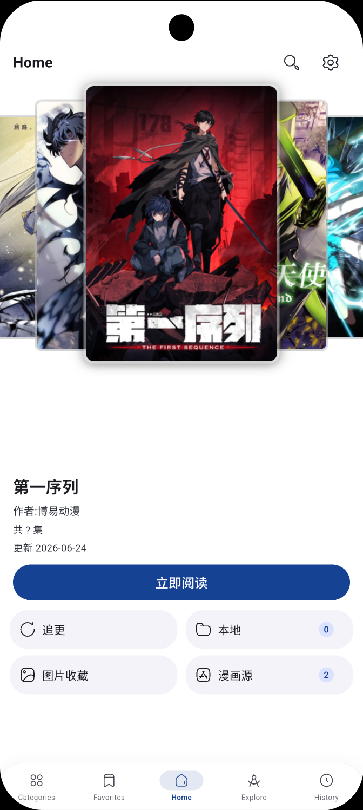
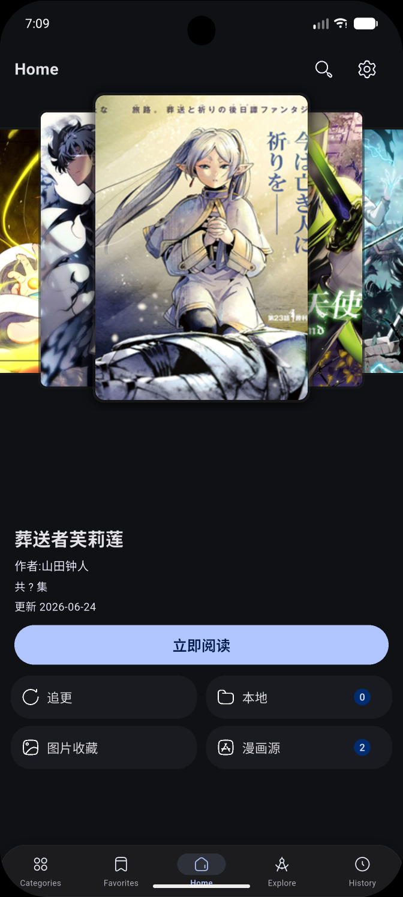

# KongComic 🎨

> 基于 [Venera](https://github.com/venera-app/venera) 二次AI开发 | UI 翻新 · Bug 修复 · 性能优化

<p align="center">
  <a href="README.en.md">English</a> | <b>中文</b>
</p>

<p align="center">
  <a href="https://github.com/SkyAlice-source/KongComic-android/releases">
    
  </a>
  <a href="LICENSE">
    
  </a>
  <a href="https://github.com/SkyAlice-source/KongComic-android/releases">
    
  </a>
</p>

<!-- 截图暂隐藏
<p align="center">
  
  
</p>
-->

---

## 🚀 快速安装

从 [Releases](https://github.com/SkyAlice-source/KongComic-android/releases) 下载 APK 安装即可。

## ✨ 功能

- **多源聚合搜索** — 跨多个漫画源一键搜索，结果集中呈现
- **在线漫画** — 基于 Venera JavaScript 漫画源，阅读来自网络的漫画
- **本地漫画** — 直接阅读设备内的本地漫画
- **漫画源管理** — 用 JavaScript 自定义 / 安装漫画源，支持仓库更新、重装与卸载
- **收藏** — 多级文件夹分类 + 自定义封面
- **离线下载** — 支持 CBZ 打包，无网也能看
- **阅读器** — 多种翻页模式 + 自动滚动，舒适阅读体验
- **评论与标签** — 源支持时查看漫画评论、标签等信息
- **账号登录** — 源支持时登录以评论、评分等
- **备份恢复** — 设置、收藏、封面一键打包导出 / 导入
- **崩溃上报** — Sentry 实时监控，线上问题可追踪

## 🔧 自行构建

环境要求：
- Flutter 3.44+（Dart 3.8+）
- JDK 17

```bash
flutter pub get
flutter build apk --release --split-per-abi
```

> 推送 `v*` 标签后，GitHub Actions 会自动构建并发布带签名的 Release APK，无需本地手动打包。

## 📄 许可

[GPL-3.0](LICENSE)

